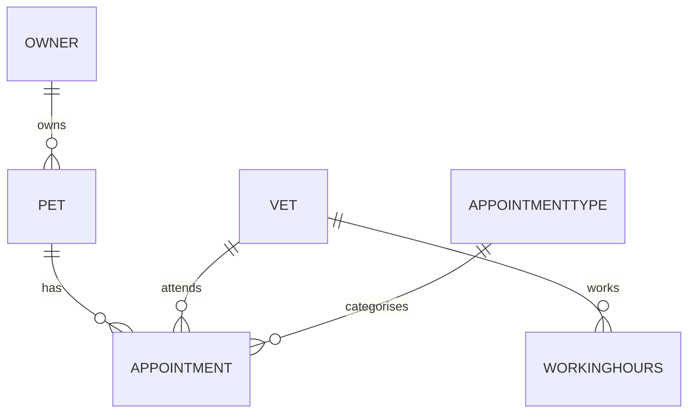

# Vet Booking API

A RESTful API for booking veterinary appointments, built with ASP.NET Core and Entity Framework Core. It manages owners, pets, vets, appointment types and bookings, with business rules to prevent double-booking.

> **Status:** In development. See the [Roadmap](#roadmap) for what is complete and what is planned.

**Live demo:** [] | **API docs:** []

---

## Table of Contents

- [Features](#features)
- [Tech Stack](#tech-stack)
- [Architecture](#architecture)
- [Domain Model](#domain-model)
- [API Endpoints](#api-endpoints)
- [Getting Started](#getting-started)
- [Configuration](#configuration)
- [Running Tests](#running-tests)
- [Design Decisions](#design-decisions)
- [Roadmap](#roadmap)
- [Screenshots](#screenshots)
- [Author](#author)

---

## Features

**Implemented**
- CRUD endpoints for appointment types (get all, get by ID, create, delete)
- Layered structure: controllers, services and data access kept separate
- Request and response DTOs, so the database model is never exposed directly
- Entity Framework Core with SQL Server, code-first migrations and seed data
- Dependency injection throughout

**Planned**
- Owners and pets management
- Vets and weekly working hours
- Appointment booking with end time calculated from the appointment type's duration
- Conflict detection: no overlapping bookings for the same vet or the same pet
- Availability endpoint that returns open slots for a vet on a given day
- Cancellation and rescheduling rules
- Authentication and role-based authorisation (owner, receptionist, vet, admin)
- Unit and integration tests
- React and TypeScript front end

---

## Tech Stack

| Area | Technology |
|---|---|
| Language | C# |
| Framework | ASP.NET Core Web API (.NET 10) |
| Data access | Entity Framework Core |
| Database | SQL Server (Express / LocalDB) |
| Testing | xUnit |
| Tooling | Git, GitHub, Visual Studio |

---

## Architecture

The API follows a simple layered design, where each layer has one responsibility.

```
Controller  →  Service  →  AppDbContext  →  SQL Server
 (HTTP)        (logic)      (data access)
```

| Layer | Responsibility |
|---|---|
| **Controllers** | Handle HTTP: routing, status codes, request and response handling |
| **Services** | Business logic and mapping between entities and DTOs, behind interfaces |
| **Data** | `AppDbContext`, table configuration and seed data |
| **Models** | Entity classes that map to database tables |
| **Dtos** | Request and response shapes exposed by the API |

### Project structure

```
VetBooking.api/
├── Controllers/    HTTP endpoints
├── Services/       Business logic (interfaces and implementations)
├── Dtos/           Request and response models
├── Models/         Database entities
├── Data/           AppDbContext and seed data
├── Migrations/     EF Core migrations
└── Program.cs      App configuration and dependency injection
```

---

## Domain Model



| Entity | Description |
|---|---|
| `Owner` | A person who books appointments |
| `Pet` | An animal belonging to an owner |
| `Vet` | A member of staff who sees patients |
| `AppointmentType` | A kind of visit, with a duration and price |
| `WorkingHours` | A vet's availability for a day of the week |
| `Appointment` | A booking linking a pet, a vet and an appointment type |

---

## API Endpoints

### Appointment types

| Method | Endpoint | Description | Success response |
|---|---|---|---|
| `GET` | `/api/AppointmentTypes` | Get all appointment types | `200 OK` |
| `GET` | `/api/AppointmentTypes/{id}` | Get one appointment type | `200 OK` / `404 Not Found` |
| `POST` | `/api/AppointmentTypes` | Create an appointment type | `201 Created` / `400 Bad Request` |
| `DELETE` | `/api/AppointmentTypes/{id}` | Delete an appointment type | `204 No Content` / `404 Not Found` |
|`PUT` | `/api/AppointmentTypes/{id}` | Update an appointment type | `200 OK` / `404 Not Found` |

**Example request**

```http
POST /api/AppointmentTypes
Content-Type: application/json

{
  "name": "Vaccination",
  "durationInMinutes": 15,
  "price": 35.00
}
```

**Example response**

```json
{
  "id": 1,
  "name": "Vaccination",
  "durationInMinutes": 15,
  "price": 35.00
}
```

*More endpoints will be documented here as they are added.*

---

## Getting Started

### Prerequisites

- [.NET SDK 10](https://dotnet.microsoft.com/download)
- SQL Server Express or LocalDB
- [EF Core tools](https://learn.microsoft.com/ef/core/cli/dotnet): `dotnet tool install --global dotnet-ef`
- An editor such as Visual Studio, VS Code or Rider

### Installation

1. **Clone the repository**
   ```bash
   git clone https://github.com/EllisBale/VetBooking.api.git
   cd VetBooking.api
   ```

2. **Set the database connection string** using user secrets (keeps it out of source control)
   ```bash
   cd VetBooking.api
   dotnet user-secrets init
   dotnet user-secrets set "ConnectionStrings:DefaultConnection" "Server=localhost\\SQLEXPRESS;Database=VetBookingDb;Trusted_Connection=true;TrustServerCertificate=true;"
   ```
   Adjust the server name if you are using LocalDB or a different instance.

3. **Create the database** by applying the migrations
   ```bash
   dotnet ef database update
   ```

4. **Run the API**
   ```bash
   dotnet run
   ```

5. Open the API at the URL shown in the console output.

---

## Configuration

| Setting | Description | How to set |
|---|---|---|
| `ConnectionStrings:DefaultConnection` | SQL Server connection string | User secrets (development) or environment variable (deployment) |

When deploying, set the connection string as an environment variable using double underscores: `ConnectionStrings__DefaultConnection`.

No credentials are stored in this repository.

---

## Running Tests

```bash
dotnet test
```

*Test projects are planned. Unit tests will cover the booking rules (overlap detection, working-hours checks, cancellation rules), and integration tests will cover the API endpoints.*

---

## Design Decisions

**Controllers, services and a data layer.** Controllers handle only HTTP concerns. Business rules live in services, so they can be unit tested without HTTP.

**Interfaces and dependency injection.** Controllers depend on service interfaces, which keeps the code loosely coupled and allows services to be mocked in tests.

**DTOs instead of exposing entities.** Responses contain only the fields the API intends to expose. Request DTOs prevent callers from setting fields such as `Id`, and the database model can change without breaking API consumers.

**Times stored in UTC.** The UK switches between GMT and BST, which makes local times ambiguous around clock changes. Storing UTC keeps overlap checks reliable, and conversion to UK time happens only when displaying or reading user input. *(Applies to appointment times, which are planned.)*

**Seed data through EF Core migrations.** A sample vet and working hours are seeded with `HasData`, so a fresh database is usable straight away. All seed data is fictional.

**User secrets for configuration.** Connection strings are never committed to the repository.

---

## Roadmap

- [x] Project setup, EF Core and SQL Server
- [x] Domain models and initial migration with seed data
- [x] Appointment types: get all, get by ID, create, delete
- [x] Appointment types: update
- [ ] Owners and pets
- [ ] Vets and working hours
- [ ] Appointments with calculated end time
- [ ] Overlap rules for vets and pets
- [ ] Availability endpoint
- [ ] Cancellation and rescheduling rules
- [ ] Authentication and roles
- [ ] Unit and integration tests
- [ ] Interactive API documentation
- [ ] React and TypeScript front end
- [ ] Docker, CI pipeline and deployment

---

## Screenshots


---

## Author

**Ellis Bale**
[Github](https://github.com/EllisBale)

Built as a portfolio project while learning ASP.NET Core.
